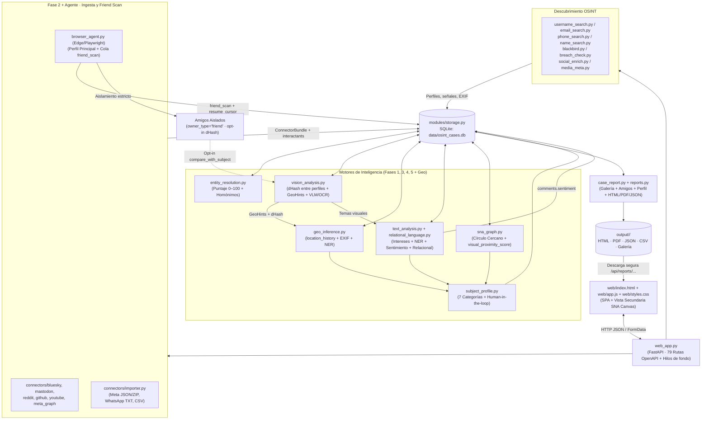

# OSINT-Auto · Plataforma Modular de Inteligencia en Fuentes Abiertas (OSINT + Visión + NLP + SNA)

**OSINT-Auto** es una aplicación web (FastAPI + SPA) y de consola en español diseñada para descubrir, consolidar, analizar y auditar huellas digitales públicas a partir de **fuentes abiertas oficiales** y **exportaciones propias autorizadas**.

Integra herramientas OSINT clásicas (Maigret, Sherlock, Holehe, Ignorant, Blackbird) con una arquitectura de **6 fases** persistida en SQLite: gestión de casos, resolución de entidades contra homónimos, conectores de APIs abiertas e importador de Meta/WhatsApp, análisis visual multimodal (`dHash` + VLM + OCR), análisis NLP de intereses/sentimiento, análisis de redes sociales y círculo cercano (**SNA** con vista secundaria interactiva) y reportes integrales con anonimización de terceros.

> **Uso responsable:** esta herramienta está pensada únicamente para fuentes públicas abiertas y cuentas/datos sobre los que tengas autorización o un fin legítimo (auditoría de tu propia huella digital, investigación defensiva, periodismo o verificación). No evade muros de inicio de sesión, CAPTCHAs ni controles anti-scraping.

---

## 1. Funcionalidades principales

### A. Descubrimiento OSINT y Auditoría
- **Búsqueda por Username y Redes Sociales:** automatiza Maigret y Sherlock, deduplica URLs, asigna confianza (`ALTA / MEDIA / BAJA`) y lee metadatos públicos abiertos (APIs públicas + Open Graph), marcando explícitamente las redes con muro de login (`login_wall`).
- **Búsqueda por Nombre y Ubicación:** consulta APIs abiertas (GitHub, ORCID, OpenAlex, Wikipedia), buscadores opcionales (Brave/Google CSE) y genera una matriz de consultas por red social con autocompletado de ciudades/países (catálogo local + OpenStreetMap Nominatim).
- **Correo electrónico y Brechas:** valida registros DNS MX, consulta Gravatar público, verifica registros con Holehe, revisa exposición en filtraciones (XposedOrNot / HIBP opcional) y audita contraseñas propias mediante **k-Anonymity** (nunca envía ni guarda la clave).
- **Teléfono:** análisis técnico internacional (`phonenumbers`: país, operador, tipo de línea, zona horaria), evaluación de líneas **VoIP / virtuales**, generador automático de **variantes de formato**, **consultas OSINT (Dorks)** en 1 clic (Google, DuckDuckGo, Bing), enlaces de verificación directa (`wa.me` / `t.me`) y consulta con Ignorant.
- **Metadatos forenses de Media:** extrae EXIF, coordenadas GPS, XMP, streams de video (`ffprobe`) y hashes SHA-256/MD5, generando además una **copia limpia sin metadatos**.
- **Pipeline Completo (5 pasos):** encadena username → correos → Blackbird → teléfono → brechas → grafo y reportes.

### B. Plataforma de Inteligencia por Casos (Fases 1 a 6)
1. **Fase 1 · Casos, SQLite y Resolución de Entidades:** agrupa todas las búsquedas bajo un *Caso*, deduplica perfiles y calcula un puntaje explicable (`0–100`) detectando enlaces cruzados, avatares repetidos, bios similares y alertas de posibles homónimos, con control manual (*Confirmar / Descartar / Auto*). Incluye botón **Rastrear OSINT con semillas** en 1 clic.
2. **Fase 2 · Conectores de APIs Abiertas e Importador:** extrae biografías completas, publicaciones, fotos y comentarios de **Bluesky (ATProto), Mastodon (ActivityPub), Reddit, GitHub y YouTube Data API v3**. Para redes cerradas (Facebook, Instagram, Threads) o mensajería, incluye un importador nativo de **exportaciones oficiales de Meta (`.json` / `.zip`)**, **chats exportados de WhatsApp (`.txt`)**, **CSV** y plantilla **JSON**.
3. **Fase 3 · Galería y Análisis Visual con IA:** calcula **hash perceptual `dHash` (64 bits)** para detectar fotos/avatares duplicados o recomprimidos, extrae paleta de colores y dimensiones, ejecuta OCR opcional y etiqueta intereses visuales usando **Ollama local**, **Gemini Vision**, **OpenAI Vision** o el motor local trazable (`local_context`).
4. **Fase 4 · NLP sobre Bios, Publicaciones y Comentarios:** separa estrictamente lo publicado por el **Sujeto** frente a comentarios de **Terceros**, fusiona temas de texto + fotos en un **Mapa Unificado de Intereses** con citas literales, evalúa sentimiento bilingüe ES/EN (con inversión por negaciones), extrae entidades (**NER**: lugares, organizaciones, dominios, hashtags) y reconstruye patrones horarios/semanales.
5. **Fase 5 · Vista Secundaria `Círculo Cercano · Laboratorio SNA`:** construye un grafo dirigido usuario↔usuario colapsando los handles del sujeto en un nodo *Ego*, calcula **Índice de Cercanía (`0–100`)** premiando reciprocidad y días activos, clasifica en 3 anillos (**Íntimo / Cercano / Periferia**), calcula centralidad de intermediación (**algoritmo de Brandes**), detecta **comunidades** y ofrece 3 vistas intercambiables: **Mapa Orbital / Red Física** (Canvas interactivo con zoom y arrastre), **Ranking del Círculo Cercano** y **Comunidades**, además de ingreso directo de interacciones/exportaciones.
6. **Fase 6 · Reporte Integral y Gobernanza de Privacidad:** calcula un **Índice Defensivo de Exposición (`0–100`)** consolidando Fases 1–5 con recomendaciones concretas, exporta el caso completo en **HTML + PDF + JSON** con **anonimización opcional de terceros** (`Tercero_01`, `Tercero_02`...) y ofrece limpieza segura de carpetas temporales huérfanas en `output/`.

### C. Investigación Autorizada de Cuentas, Lenguaje Relacional y Agente Navegador
1. **Investigación Autorizada y OAuth2 (`account_investigator.py` + `platform_auth.py` + `meta_graph.py`):** expone una matriz real de capacidades por plataforma (`PlatformCapabilities`), conecta cuentas autorizadas mediante **OAuth2 PKCE** (tokens cifrados localmente en `platform_connections`, cero contraseñas almacenadas) para **Meta Graph API** (Instagram Pro / Facebook Pages) y **Reddit**, profundiza respuestas anidadas y reacciones en conectores abiertos, y registra trazabilidad inmutable en `profile_snapshots` y `evidence_records`.
2. **Lenguaje Relacional Contextual (`relational_language.py`):** analiza comentarios, respuestas y bios para detectar expresiones de **familia, amistad, pareja y entorno laboral/académico** considerando regionalismos, diminutivos, errores ortográficos (`hemano`, `hno`, etc.), emojis y marcadores de sarcasmo o tercera persona. Distingue estrictamente entre **observación explícita (`explicit`)**, **expresión ambigua (`ambiguous`)** e **inferencia del modelo (`model_inference`)**, permitiendo revisión humana (*Validar / Ambiguo / Descartar*) desde el caso y el Inspector SNA.
3. **Agente de Navegación Supervisada (`browser_agent.py` + `browser_adapters/`):** permite seleccionar una plataforma (`Instagram`, `Facebook`), iniciar sesión manualmente en una ventana real de **Microsoft Edge** sin flags de automatización (guardando cookies localmente en `data/browser_profiles/<platform>`), recorrer perfiles públicos autorizados con **Pausa / Reanudar / Cancelar**, pausar automáticamente ante CAPTCHAs o checkpoints (`paused_checkpoint` sin evadir controles), revisar o eliminar hallazgos en una bandeja previa (`browser_staged_items`) e integrarlos selectivamente al caso (NLP, Lenguaje Relacional y SNA).

### D. Círculo de Interacción Ampliado y Geolocalización Visual Contextual
1. **Registro nominal de interactuantes (`interactants` + `comments.interactant_id`):** persiste autor, nombre visible, URL de perfil y relaciones de respuesta (`is_reply`, `parent_comment_id`) desde adaptadores de navegador y `ConnectorBundle`, agrupando métricas por publicación y anonimizando determinísticamente (`Tercero_NN`) en HTML/PDF/JSON.
2. **Investigación de cuentas amigas (`friend_scan` + `visual_proximity_score`):** identifica candidatos con `>= FRIEND_CANDIDATE_MIN_INTERACTIONS` o reciprocidad, exige confirmación explícita opt-in (`authorized: true`), procesa una cola FIFO supervisada (limitada por `MAX_FRIEND_PROFILES` y `FRIEND_SCAN_DELAY_SECONDS`, pausando en `paused_checkpoint` ante CAPTCHA/login sin evadir), compara fotos mediante `dHash` (`compare_media_between_profiles`), consolida historial cronológico y **retorna al perfil principal** reanudando desde `resume_cursor` (`SCANNING_PRIMARY_RESUME`).
3. **Geolocalización visual probabilística (`extract_geo_hints` + `geo_inference.py`):** extrae `GeoHints` por imagen (flora, arquitectura, OCR, clima, objetos distintivos y EXIF GPS con máxima prioridad), los fusiona con NER de Fase 4 y produce un ranking `country → region → city` usando lenguaje estrictamente probabilístico (*"compatible con"*, *"posible"*). OpenStreetMap Nominatim permanece deshabilitado por defecto (`GEO_NOMINATIM_ENABLED=false`).
4. **Criterios éticos y troubleshooting:** solo perfiles públicos autorizados; si aparece un muro de login o CAPTCHA en `friend-scan`, la cola pasa a `paused_checkpoint` hasta intervención humana; si `dHash` no arroja coincidencias, revisa que la galería haya sido analizada en Fase 3 y ajusta `DHASH_HAMMING_THRESHOLD` (default `10`).

### E. Geolocalización Interactiva, Amigos Aislados y Perfil del Sujeto
1. **Geolocalización por foto e historial cronológico (`location_history`):** desde **Galería / Visión**, cada miniatura permite pulsar **Investigar ubicación** (`POST /api/cases/{id}/media/{media_id}/geo-investigate`) o fijar una **ubicación manual** (`is_manual_override=1`, que prevalece en reportes). El historial se ordena por `published_at` (`GET /api/cases/{id}/location-history`) con exportación CSV y mapa Canvas interactivo.
2. **Amigos por link con aislamiento estricto (`owner_type='friend'`):** en **Agente Navegador → Cuentas amigas** puedes añadir URLs públicas (`POST /api/cases/{id}/friends`). Si la URL requiere login/CAPTCHA queda en `pending_manual` sin evadir controles. Todo su contenido se almacena aislado (`friend_scope_enabled=0` por defecto), con investigación propia (`POST /api/cases/{id}/friends/{friend_id}/investigate`), comparación `dHash` opt-in (`compare_with_subject=true`) y borrado en cascada aislado (`DELETE /api/cases/{id}/friends/{friend_id}`).
3. **Perfil enriquecido del sujeto (`subject_profile.py`):** consolida **7 categorías** (*hobbies, places, friends, ideas, personality, occupation, relationship_status*) con `confidence`, `evidence_refs`, `epistemic_status` y revisión humana (`Validar / Descartar`). `relationship_status` e `ideas` nunca se marcan `explicit` sin cita literal.
4. **Reporte extendido:** añade galería de fotos con ubicación, **Círculo de Amigos Relacionados** (con checkbox opt-in `reveal_confirmed_friends` auditado) y **Perfil Enriquecido del Sujeto** en HTML, PDF y JSON (`media_gallery`, `friends_circle`, `location_history`, `subject_profile`).

---

## 2. Mapa completo de archivos (¿Para qué sirve cada uno?)

### Raíz del proyecto
| Archivo | Propósito |
|---|---|
| `web_app.py` | **Servidor principal (FastAPI + REST API).** Expone 79 rutas OpenAPI, sirve la interfaz web (`web/`), coordina trabajos asíncronos en hilos de fondo y conecta todos los módulos de `modules/`. |
| `osint_auto.py` | **Interfaz alternativa por consola (CLI).** Menú interactivo clásico en terminal para lanzar búsquedas de descubrimiento OSINT sin usar navegador. |
| `requirements.txt` | Dependencias Python del proyecto (`fastapi`, `uvicorn`, `requests`, `pillow`, `fpdf2`, `phonenumbers`, `dnspython`, `python-dotenv`, `playwright`, etc.). |
| `.env` | *(Local, ignorado por git)* Claves API opcionales (`GEMINI_API_KEY`, `OPENAI_API_KEY`, `OLLAMA_URL`, `HIBP_API_KEY`, `YOUTUBE_API_KEY`, `GITHUB_TOKEN`, `BRAVE_API_KEY`, `GOOGLE_CSE_KEY`, `GOOGLE_CSE_CX`). |
| `.gitignore` | Evita subir datos locales sensibles o generados (`output/`, `data/`, `.env`, `.venv/`, `__pycache__/`). |

### Carpeta `modules/` (lógica de negocio y motores de análisis)
| Archivo | Capa / Fase | Qué hace exactamente |
|---|---|---|
| `modules/utils.py` | Base | Utilidades transversales: colores de consola, detección de herramientas CLI (`TOOLS`), ejecución segura de subprocesos y gestión de `OUTPUT_ROOT` (`output/`). |
| `modules/username_search.py` | OSINT | Ejecuta Maigret y Sherlock sobre un username (con filtro por país y modo `--tags social`). |
| `modules/email_search.py` | OSINT | Validación DNS MX, consulta de perfil público Gravatar, Holehe y derivación de usernames/correos. |
| `modules/phone_search.py` | OSINT | Análisis técnico con `phonenumbers` (E.164, región, operador, tipo de línea), evaluación VoIP/virtual, variantes de formato, dorks en 1 clic, enlaces `wa.me`/`t.me` e Ignorant. |
| `modules/name_search.py` | OSINT | Búsqueda por nombre + ciudad/país en GitHub, ORCID, OpenAlex, Wikipedia, Brave/Google CSE opcional y matriz de consultas por red. |
| `modules/blackbird.py` | OSINT | Envoltorio y parser de salida para la herramienta opcional Blackbird. |
| `modules/breach_check.py` | OSINT | Consulta de correos en brechas (XposedOrNot y HIBP opcional) + auditoría de contraseñas propias vía k-Anonymity (prefijo SHA-1). |
| `modules/social_enrich.py` | OSINT | Enriquecimiento público sin login (Open Graph, APIs abiertas), grafo básico de huella digital y evaluación defensiva básica. |
| `modules/media_meta.py` | OSINT / Forense | Extracción EXIF/GPS/XMP, `ffprobe` para videos, hashes SHA-256/MD5 y generador de copia limpia sin metadatos. |
| `modules/reports.py` | Reportes base | Deduplicación multi-herramienta, scoring `ALTA/MEDIA/BAJA`, escritura de CSV, HTML y PDF (`fpdf2`). |
| `modules/storage.py` | **Fase 1–6 + Agente** | Capa SQLite (`data/osint_cases.db`) en modo WAL. Define y migra automáticamente las tablas base (`cases`, `entities`, `identifiers`, `profiles`, `posts`, `media_items`, `comments`, `interactions`, `case_runs`, `jobs`) y las de trazabilidad/agente (`platform_connections`, `profile_snapshots`, `reactions`, `evidence_records`, `relational_signals`, `browser_agent_runs`, `browser_staged_items`). |
| `modules/entity_resolution.py` | **Fase 1** | Motor puro de Resolución de Entidades: evalúa confianza OSINT, especificidad del username, enlaces cruzados, avatares repetidos, similitud de bios y contradicciones de ubicación para alertar homónimos. |
| `modules/vision_analysis.py` | **Fase 3** | Motor de visión: `dHash` 64-bit con Pillow, distancia de Hamming para duplicados, paleta de colores, OCR opcional (`tesseract`), clientes VLM (Ollama, Gemini/Vertex Express, OpenAI) y agregación de temas visuales. |
| `modules/text_analysis.py` | **Fase 4** | Motor NLP bilingüe (ES/EN): separación Sujeto vs. Terceros, sentimiento con ventana de negación, fusión multimodal Texto + Fotos, NER ligero, patrones temporales y síntesis opcional con LLM. |
| `modules/sna_graph.py` | **Fase 5** | Motor de teoría de grafos: unificación de Ego, Índice de Cercanía (`0–100`), reciprocidad, anillos, centralidad de Brandes, detección de comunidades (Label Propagation ponderado) y señales relacionales trazables (`relational_cues`). |
| `modules/case_report.py` | **Fase 6** | Evaluación defensiva de exposición (`0–100`), anonimización determinista de terceros (`Tercero_01`…), exportación integral del caso (HTML + PDF + JSON, incluyendo señales relacionales anonimizadas) e higiene/limpieza de temporales huérfanos en `output/`. |
| `modules/platform_auth.py` | **OAuth2 / Seguridad** | Flujos OAuth2 PKCE con protección anti-CSRF (`state`) y cifrado local de tokens (`data/.key` o `OSINT_TOKEN_SECRET`), sin almacenar contraseñas. |
| `modules/account_investigator.py` | **Investigador** | Orquestador de investigación de cuentas autorizadas: valida `PlatformCapabilities`, ingiere snapshots/evidencias y encadena Lenguaje Relacional + NLP + SNA. |
| `modules/relational_language.py` | **Relacional** | Motor en 4 capas (normalización regional/diminutivos/typos/emojis, desambiguación de coloquialismos/sarcasmo/3.ª persona, separación `explicit`/`ambiguous`/`model_inference` y revisión humana). |
| `modules/browser_agent.py` | **Agente Navegador** | Gestor de sesiones supervisadas: login manual en Microsoft Edge nativo (`data/browser_profiles/<platform>`), ejecución Playwright con Pausa/Reanudar/Cancelar, bandeja de revisión (`browser_staged_items`), cola `friend_scan`, captura aislada por link e integración selectiva al caso. |
| `modules/geo_inference.py` | **Geolocalización** | Fusión probabilística de `GeoHints` + EXIF GPS (`gps_lat`/`gps_lon`) + NER/ubicaciones en ranking `country → region → city` con centroides para mapa Canvas y Nominatim opt-in (`GEO_NOMINATIM_ENABLED=false`). |
| `modules/subject_profile.py` | **Perfil del Sujeto** | Consolida 7 categorías (`hobbies`, `places`, `friends`, `ideas`, `personality`, `occupation`, `relationship_status`) con `confidence`, `evidence_refs`, `epistemic_status` conservador y revisión humana (`pending/validated/ambiguous/discarded`). |

### Carpeta `modules/connectors/` y `modules/browser_adapters/`
| Archivo | Qué hace |
|---|---|
| `modules/connectors/__init__.py` | Catálogo central (`connectors_catalog`) con `PlatformCapabilities` y despachador único `fetch_from_connector(...)`. |
| `modules/connectors/common.py` | Limpieza HTML→texto, extracción de `@menciones`/`#hashtags` y contrato unificado `ConnectorBundle`. |
| `modules/connectors/bluesky.py` | Conector oficial ATProto (`public.api.bsky.app`, sin clave): perfil, feed, imágenes con alt-text, respuestas y reacciones públicas. |
| `modules/connectors/mastodon.py` | Conector oficial ActivityPub para cualquier instancia (`@user@instancia`): perfil, campos verificados, estados, adjuntos, contextos y favoritos. |
| `modules/connectors/reddit.py` | Conector JSON público y OAuth2 opcional de Reddit (`/about.json`, `/submitted.json`, `/comments.json` e hilos de respuestas de terceros). |
| `modules/connectors/github.py` | Conector REST oficial de GitHub (soporta `GITHUB_TOKEN` opcional): bio, repositorios/temas y actividad colaborativa. |
| `modules/connectors/youtube.py` | Conector YouTube Data API v3 (requiere `YOUTUBE_API_KEY`): canal, videos, miniaturas, comentarios y respuestas anidadas. |
| `modules/connectors/meta_graph.py` | Conector oficial **Meta Graph API (OAuth2)** para cuentas propias de Instagram Professional, `Business Discovery` y Páginas de Facebook administradas. |
| `modules/connectors/importer.py` | Importador universal: plantilla OSINT-Auto (JSON/CSV), **exportaciones oficiales de Meta (Facebook/Instagram/Threads `.json` y `.zip`)** con corrección de codificación, y **chats de WhatsApp (`.txt`)**. |
| `modules/browser_adapters/base.py` | Clase base del Agente Navegador con detección de muros de login, CAPTCHAs y checkpoints (`detect_security_or_login_gate`) para pausar sin evadir controles. |
| `modules/browser_adapters/instagram.py` | Adaptador supervisado de Instagram Web: normalización de URL, extracción de perfil, publicaciones (`h1` / `og:description`), imágenes y comentarios/respuestas visibles. |
| `modules/browser_adapters/facebook.py` | Adaptador supervisado de Facebook Web: extracción de perfil/página pública visible, publicaciones, imágenes y comentarios disponibles. |

### Carpeta `web/` (Interfaz Web SPA)
| Archivo | Qué hace |
|---|---|
| `web/index.html` | Estructura de la SPA con todas las vistas: Dashboard, **Casos y Entidades**, **Agente Navegador**, **Vista Secundaria Círculo Cercano · SNA**, Username, Redes Sociales, Nombre/Ubicación, Correo, Teléfono, Brechas, Metadatos de Media, Búsqueda Completa e Historial/Gobernanza. |
| `web/app.js` | Toda la lógica del navegador: navegación entre vistas, selector global de *Caso activo*, polling en vivo de jobs y del Agente Navegador, gestor de sesiones OAuth2/Edge, revisión de Lenguaje Relacional, consultas de teléfono y el motor gráfico **Canvas HiDPI** del Laboratorio SNA. |
| `web/styles.css` | Sistema de diseño oscuro analítico, diseño responsivo, barras de puntaje/sentimiento, galería visual y HUD del Laboratorio SNA. |

### Carpeta `tests/` (Verificación automatizada · 59 pruebas)
| Archivo | Qué valida |
|---|---|
| `tests/test_phase1_storage_resolution.py` | Resolución de entidades (enlaces cruzados, avatares, homónimos, override manual), ciclo de vida SQLite y handlers REST de casos. |
| `tests/test_phase2_connectors_import.py` | Conectores Bluesky/Mastodon/Reddit/GitHub (con mocks HTTP), importador JSON/CSV y deduplicación en doble ingesta. |
| `tests/test_phase3_vision.py` | `dHash` ante recompresión/redimensionado, motor `local_context`, mock de Ollama VLM y agrupación de temas/duplicados. |
| `tests/test_phase4_nlp.py` | Sentimiento con negaciones, NER, línea de tiempo, separación Sujeto vs. Terceros, fusión Texto+Fotos y actualización de `comments.sentiment`. |
| `tests/test_phase5_sna.py` | Reciprocidad, anillos de cercanía, comunidades, exportación ZIP de Meta, chat `.txt` de WhatsApp e ingreso manual en SNA. |
| `tests/test_phase6_report_governance.py` | Reporte integral (HTML/PDF/JSON), verificación estricta de anonimización sin fugas y limpieza segura de temporales huérfanos. |
| `tests/test_relational_language.py` | Reglas de familia/amistad/pareja, regionalismos, diminutivos, errores ortográficos, sarcasmo, 3.ª persona, separación epistemológica, revisión humana y su reflejo en SNA. |
| `tests/test_account_investigation.py` | Matriz de `PlatformCapabilities`, cifrado de tokens OAuth2, protección anti-CSRF (`state`), conector Meta Graph/Reddit (mock) y reporte integral anonimizado. |
| `tests/test_browser_agent.py` | Detección de muros/CAPTCHAs sin evasión, máquina de estados Pausa/Reanudar/Cancelar, gestión de sesiones locales y filtrado/consolidación al caso. |
| `tests/test_interactants_capture.py` | Captura nominal de interactuantes, `interactant_id` no nulo y umbral de candidato amigo. |
| `tests/test_friend_scan_state_machine.py` | Cola FIFO de cuentas amigas, opt-in obligatorio, retorno al perfil principal (`resume_cursor`) y `paused_checkpoint`. |
| `tests/test_visual_proximity.py` | Comparación `dHash` entre perfiles, `visual_proximity_score` en SNA e historial consolidado de amigos. |
| `tests/test_geo_hints_inference.py` | Extractores `GeoHints` (mock VLM + `local_context`), prioridad EXIF GPS, lenguaje probabilístico y Nominatim desactivado por defecto. |
| `tests/test_report_anonymization_extended.py` | Anonimización determinista `Tercero_NN` extendida a interactuantes, evidencia de amigos, `source_url` y `evidence_refs`. |
| `tests/test_location_history.py` | Investigación de foto individual, override manual prevalente, orden cronológico por `published_at` y exportación CSV. |
| `tests/test_friends_by_link.py` | Alta manual por URL (`pending_manual` en login-wall), resumen público aislado, enlace SNA opt-in y borrado en cascada aislado. |
| `tests/test_friend_isolation.py` | Aislamiento estricto (`friend_scope_enabled=0`) verificando cero fugas en vistas/NLP/ubicación/perfil del sujeto. |
| `tests/test_report_gallery_friends.py` | Galería con ubicación/miniaturas/filtros en reporte, círculo de amigos y revelación opt-in auditada. |
| `tests/test_subject_profile.py` | 7 categorías del perfil del sujeto, reglas duras epistemológicas (`ideas`/`relationship_status`) y revisión humana `validated/ambiguous/discarded`. |

### Carpetas generadas en tiempo de ejecución (ignoradas por git)
- `data/osint_cases.db`: base de datos SQLite principal donde viven los casos, perfiles, publicaciones, comentarios, fotos, análisis, señales relacionales, evidencias y runs del agente.
- `data/browser_profiles/<platform>`: perfiles persistentes locales de navegador para sesiones iniciadas manualmente por el usuario (sin guardar contraseñas).
- `output/<fecha>_<tipo>_<objetivo>/`: archivos crudos de herramientas CLI, copias limpias de fotos, galerías subidas y reportes exportados (`resumen.html`, `reporte_final.pdf`, `caso_completo.json`, CSVs).

---

## 3. Cómo se conectan los archivos entre sí



### Flujo de datos paso a paso
1. **Creación y captura:** creas un caso en la UI (`web/app.js` → `POST /api/cases` → `storage.py`). Al activar ese caso o pulsar **Rastrear OSINT con semillas**, `web_app.py` lanza los módulos de descubrimiento en segundo plano y al terminar llama a `storage.ingest_job_result_to_case(...)`, que guarda perfiles/identificadores y ejecuta automáticamente `entity_resolution.py`.
2. **Ingesta de contenido:** cuando usas un conector abierto (`POST /api/cases/{id}/ingest/connector`) o subes un archivo de Meta/WhatsApp/JSON/CSV (`POST /api/cases/{id}/ingest/import`), todo se convierte al mismo formato `ConnectorBundle` (`connectors/common.py`) y `storage.ingest_connector_bundle(...)` lo guarda deduplicado en `posts`, `media_items`, `comments` e `interactions`.
3. **Capas encadenadas de análisis:**
   - **Visión (`vision_analysis.py`)** lee `media_items` (más el caption del post relacionado), guarda `dhash`, `ocr_text` y `tags` en SQLite.
   - **NLP (`text_analysis.py`)** lee biografías + `posts` + `comments` + los temas visuales de Fase 3, produce el **Mapa Unificado de Intereses** y escribe la polaridad de cada comentario en `comments.sentiment`.
   - **SNA (`sna_graph.py`)** lee `interactions` + `comments` (ya etiquetados con sentimiento), calcula el grafo, los 3 anillos del círculo cercano y las comunidades, y la vista secundaria en `web/app.js` los renderiza en el Canvas interactivo.
4. **Salida y gobernanza:** `case_report.py` reúne todas las capas anteriores, calcula la exposición defensiva, anonimiza terceros si la casilla está activa y escribe `resumen.html`, `reporte_final.pdf` y `caso_completo.json` dentro de `output/`.

---

## 4. ¿Por qué se diseñó así? (Decisiones de arquitectura)

1. **SQLite embebido en modo WAL en lugar de PostgreSQL/Neo4j:**
   Permite que cualquier usuario ejecute el proyecto localmente en Windows/Linux con **cero instalación de servidores de base de datos**, manteniendo integridad referencial (`ON DELETE CASCADE`), borrado limpio de casos y concurrencia segura entre los hilos de FastAPI.
2. **Contrato único `ConnectorBundle` para APIs abiertas e Importador:**
   Separar la *fuente* (Bluesky, Mastodon, Reddit, GitHub, YouTube, Meta ZIP, WhatsApp TXT) del *almacenamiento y análisis* permite agregar nuevas fuentes sin tocar ni una línea de Visión, NLP, SNA o Reportes.
3. **APIs oficiales y exportaciones propias en vez de scraping con cuentas falsas:**
   Automatizar cuentas secundarias detrás de login (Instagram/Facebook/Threads) rompe sus Términos de Servicio, dispara CAPTCHAs/bloqueos y vuelve inestable la aplicación. Por eso el sistema usa APIs abiertas cuando existen, marca `login_wall` cuando una red está cerrada, y ofrece importación nativa de exportaciones oficiales de Meta/WhatsApp + registro manual en el Laboratorio SNA.
4. **Puntajes explicables + control humano (*Human-in-the-loop*):**
   Tanto en Resolución de Entidades (Fase 1) como en Intereses (Fases 3–4) y SNA (Fase 5), el sistema **nunca actúa como caja negra**: cada puntaje muestra sus razones exactas, cada interés muestra citas literales/fotos de respaldo y el analista puede confirmar o descartar perfiles manualmente para evitar errores por homonimia o sarcasmo.
5. **Motores de IA intercambiables con respaldo 100% local:**
   Visión (`dHash` + paleta + contexto/OCR) y NLP (léxico ES/EN + negaciones + NER + timeline) funcionan incluso **sin internet ni GPU**, y escalan automáticamente a IA generativa en cuanto detectan **Ollama local**, **Gemini (`GEMINI_API_KEY`)** u **OpenAI (`OPENAI_API_KEY`)** en `.env`.
6. **Grafo SNA en Canvas HTML5 propio (cero dependencias externas de frontend):**
   Evita depender de CDNs externos para librerías de grafos, garantiza arranque instantáneo incluso sin salida a internet y permite personalizar por completo los **Anillos de Cercanía (Orbital)**, la **Red Física (Force-Directed)** y el **Inspector de Relación**.
7. **Privacidad por diseño:**
   La exportación integral activa **Anonimizar terceros** por defecto, separa `output/` y `data/` en `.gitignore`, usa validación anti-*path traversal* al servir o borrar archivos y ofrece limpieza controlada de temporales huérfanos.

---

## 5. Instalación y ejecución

### Requisitos
- Python 3.9+ (probado en Python 3.12)
- Opcional (para descubrimiento CLI): `pipx` para instalar `maigret`, `sherlock-project`, `holehe`, `ignorant`

### 1) Entorno e instalación
```bash
cd OSINT-Auto
python -m venv .venv
.venv\Scripts\activate          # Linux/macOS: source .venv/bin/activate
pip install -r requirements.txt
```

### 2) Variables opcionales en `.env`
Crea un archivo `.env` en la raíz solo con las integraciones que quieras activar (todas son opcionales):
```env
# IA Multimodal (Visión Fase 3 y Síntesis NLP Fase 4) — compatible con AI Studio (AIza...) y Vertex AI Express (AQ...)
GEMINI_API_KEY=
GEMINI_VISION_MODEL=gemini-2.5-flash
GEMINI_TEXT_MODEL=gemini-2.5-flash

# Alternativas opcionales de IA
OPENAI_API_KEY=
OLLAMA_URL=http://127.0.0.1:11434
OLLAMA_VISION_MODEL=qwen2.5-vl
OLLAMA_TEXT_MODEL=llama3.2

# Conectores y OSINT opcionales
YOUTUBE_API_KEY=
GITHUB_TOKEN=
HIBP_API_KEY=
BRAVE_API_KEY=
GOOGLE_CSE_KEY=
GOOGLE_CSE_CX=

# OAuth2 oficial (opcional — solo tokens cifrados, nunca contraseñas)
META_APP_ID=
META_APP_SECRET=
REDDIT_CLIENT_ID=
REDDIT_CLIENT_SECRET=
OSINT_TOKEN_SECRET=

# Círculo de Interacción Ampliado y Geolocalización Visual (opcional)
FRIEND_CANDIDATE_MIN_INTERACTIONS=2
MAX_FRIEND_PROFILES=10
FRIEND_SCAN_DELAY_SECONDS=5
DHASH_HAMMING_THRESHOLD=10
GEO_NOMINATIM_ENABLED=false
```

> **Callback OAuth2 local:** al registrar una app gratuita en *Meta for Developers* o *Reddit Apps*, configura como Redirect URI:
> - `http://127.0.0.1:8000/api/auth/instagram_pro/callback`
> - `http://127.0.0.1:8000/api/auth/facebook_page/callback`
> - `http://127.0.0.1:8000/api/auth/reddit/callback`

### 3) Arrancar la aplicación
```bash
# Interfaz Web (recomendada)
.venv\Scripts\python.exe web_app.py
# Abre http://127.0.0.1:8000 (documentación interactiva Swagger en /docs)

# O menú clásico por consola
.venv\Scripts\python.exe osint_auto.py
```

### 4) Ejecutar la suite de pruebas (59 pruebas)
```bash
.venv\Scripts\python.exe -m unittest discover -s tests -v
```

---

## 6. Principales endpoints REST (`/docs`)

| Grupo | Endpoints |
|---|---|
| **Estado** | `GET /api/status`, `GET /api/connectors`, `GET /api/vision/status`, `GET /api/nlp/status` |
| **OSINT clásico** | `POST /api/search/username`, `/social`, `/name`, `/email`, `/phone`, `/full`, `/breach/email`, `/breach/password`, `/media/inspect` |
| **Fase 1 (Casos)** | `GET/POST /api/cases`, `GET/PATCH/DELETE /api/cases/{id}`, `POST/DELETE /api/cases/{id}/identifiers`, `POST/PATCH /api/cases/{id}/profiles`, `POST /api/cases/{id}/resolve` |
| **Fase 2 (Ingesta)** | `POST /api/cases/{id}/ingest/connector`, `POST /api/cases/{id}/ingest/import`, `GET /api/cases/{id}/content`, `GET /api/ingest/template`, `GET /api/cases/{id}/interactants` |
| **Fase 3 (Visión + Geo)** | `POST /api/cases/{id}/media/upload`, `POST /api/cases/{id}/vision/analyze`, `GET /api/cases/{id}/vision`, `GET /api/cases/{id}/geo-hints`, `POST /api/cases/{id}/geo-hints/recompute`, `POST /api/cases/{id}/media/{media_id}/geo-investigate`, `GET /api/cases/{id}/location-history` |
| **Fase 4 (NLP + Perfil Sujeto)** | `POST /api/cases/{id}/nlp/analyze`, `GET /api/cases/{id}/nlp`, `GET /api/cases/{id}/subject-profile`, `POST /api/cases/{id}/subject-profile/recompute`, `PATCH /api/cases/{id}/subject-profile/{entry_id}` |
| **Fase 5 (SNA)** | `GET /api/cases/{id}/sna`, `POST /api/cases/{id}/sna/recompute`, `POST /api/cases/{id}/sna/interaction` |
| **Investigación Autorizada y Relacional** | `GET /api/platforms/capabilities`, `GET /api/auth/connections`, `GET /api/auth/{platform}/start`, `GET /api/auth/{platform}/callback`, `DELETE /api/auth/connections/{id}`, `POST /api/cases/{id}/investigate/account`, `GET/POST /api/cases/{id}/relational`, `PATCH /api/cases/{id}/relational/{signal_id}`, `GET /api/cases/{id}/evidences` |
| **Agente Navegador, Friend Scan y Amigos Aislados** | `GET /api/agent/sessions`, `POST /api/agent/session/open`, `DELETE /api/agent/session/{platform}`, `POST /api/cases/{id}/agent/start`, `GET /api/agent/runs/{run_id}`, `POST /api/agent/runs/{run_id}/pause\|resume\|cancel`, `PATCH/DELETE /api/agent/runs/{run_id}/items/{item_id}`, `POST /api/agent/runs/{run_id}/commit`, `POST /api/cases/{id}/agent/friend-scan`, `GET /api/cases/{id}/agent/friend-scan/{run_id}`, `GET /api/cases/{id}/friend-evidence`, `GET/POST /api/cases/{id}/friends`, `GET/DELETE /api/cases/{id}/friends/{friend_id}`, `POST /api/cases/{id}/friends/{friend_id}/crawl\|investigate\|link-sna` |
| **Fase 6 (Reportes)** | `GET /api/cases/{id}/exposure`, `POST /api/cases/{id}/report`, `GET /api/maintenance/storage`, `POST /api/maintenance/cleanup` |

---

## 7. Solución rápida de problemas

- **`net::ERR_INTERNET_DISCONNECTED` hacia `127.0.0.1:8000`:** en Edge/Chrome DevTools (pestaña *Network*) verifica que el selector esté en **`No throttling`** y no en **`Offline`**, y confirma que `web_app.py` siga abierto en la terminal.
- **Un amigo añadido por URL queda en `pending_manual` o pide login/CAPTCHA:** `OSINT-Auto` nunca evade controles de acceso ni CAPTCHAs. Si tienes autorización legítima, abre tu sesión manualmente desde **Agente Navegador → Abrir navegador (Edge)** o usa la exportación oficial JSON/ZIP del perfil.
- **Una foto no arroja pistas suficientes al pulsar "Investigar ubicación":** verifica que `GEMINI_API_KEY`, `OPENAI_API_KEY` u Ollama esté activo en `.env` para habilitar lectura visual VLM, o usa el formulario **Fijar ubicación manual** (`is_manual_override=1`) para confirmar la ubicación con trazabilidad del analista.
- **El Círculo Cercano aparece vacío tras buscar en Facebook/Instagram/Threads:** esas redes no exponen comentarios ni amigos sin login. Usa en la vista **Círculo Cercano · SNA** el bloque **`+ Alimentar Círculo Cercano`** para subir una exportación oficial de Meta (`.json`/`.zip`), un chat de WhatsApp (`.txt`) o registrar interacciones manualmente.
- **Las fotos salen con `motor=local_context` y sin descripción:** configura `GEMINI_API_KEY`, `OPENAI_API_KEY` o instala Ollama con un modelo de visión (`ollama pull qwen2.5-vl`), reinicia `web_app.py` y vuelve a analizar desmarcando *Solo pendientes*.
- **Cambios en `.env` no se reflejan:** `.env` se carga al arrancar el proceso; detén `web_app.py` (`Ctrl + C`) y vuelve a iniciarlo.
